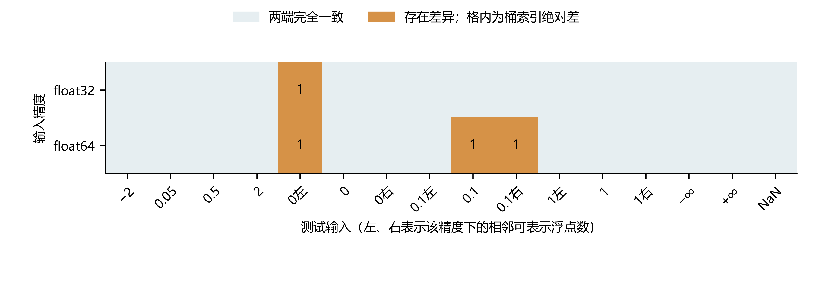
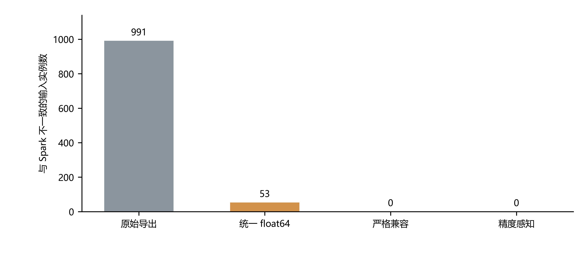
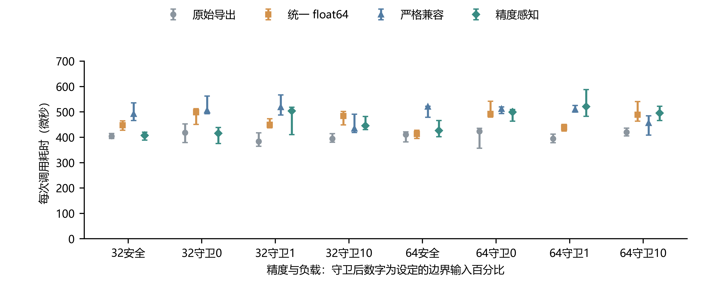

# Kamae 复现、扩展验证与精度感知导出实验

## 实验目标与大数据关联

本实验验证同一拟合后的 Spark 数据预处理管道与其导出的 Keras 模型是否产生一致输出。大数据处理部分为 Spark 对 MovieLens 用户、电影和评分数据的读取、关联、分组统计、词表构建与预处理。Kamae 将该管道转换为可在模型服务侧使用的 Keras 模型，核心是离线批处理与在线预处理的一致性。本次使用 CPU 单机 local[1] 验证语义正确性，不据此推断分布式吞吐、集群扩展性或推荐准确率。

## 独立复跑方法

使用 A 原始的 reproduction/scripts/run_movielens_pipeline.py 和 verify_movielens_parity.py，未修改 A 脚本与 src 源码。按其流程重新下载官方 MovieLens 1M 原始数据、拟合管道、生成 Parquet 和 Keras 文件，再运行原校验。原校验的 128 行、四个输出全部 PASS。本次使用 C 自己生成的文件完成验证；不需要以 A 旧产物为输入。

实验采用 Windows、Python 3.10.20、Spark 4.2.1、TensorFlow 2.21.0、Keras 3.12.4 和 Java 17，以 CPU、本机 local[1] 模式执行。独立验证器读取同一批记录的原始输入与 Spark 输出，使用对应的已保存 Keras 模型进行推理。

## 全量一致性结果

在原校验通过后，C 使用独立验证器以 4096 行为一批，比较全部 1,000,209 行。每批原始输入与 Spark 输出来自同一组 Parquet 记录，不依赖跨文件行顺序。四个输出均为离散索引或独热 0/1，因此采用逐元素精确比较。保留原始 dtype 和形状，仅移除显式的单元素包装维；拒绝用任意 reshape 隐藏形状错误。

| 输出字段 | 比较元素数 | 不一致元素数 | 最大绝对误差 | 平均绝对误差 |
|---|---:|---:|---:|---:|
| UserID_indexed | 1,000,209 | 0 | 0 | 0 |
| MovieID_indexed | 1,000,209 | 0 | 0 | 0 |
| Occupation_indexed | 21,004,389 | 0 | 0 | 0 |
| Genres_indexed | 6,001,254 | 0 | 0 | 0 |

共比较 29,006,061 个输出元素，全量通过。误差使用 float64 汇总，未先将 Spark 输出降低为 float32。这里的 0 表示所测试输出完全一致，不代表所有可能管道与输入都一定等价。

## 训练参数冻结后的新数据与多算子验证

为验证训练参数冻结后的跨框架一致性，将 MovieLens 数据按时间及稳定排序键划分为 800,167 行训练集和 200,042 行测试集。词表、均值和总体标准差全部由训练集学习，测试阶段保持固定。训练与测试记录的 row_id 无重叠；切分处同秒记录按后续排序键确定归属。

保留原五阶段类别管道，并增加 float32、float64 两条“事件时间天数 → 标准化 → 乘以 0.1 → 分桶”分支，共 11 个阶段。事件时间采用固定换算 (Timestamp−946684800)/86400，分桶阈值为 [-1, 0, 0.1, 1]。导出模型保留各数值阶段的中间输出，以检查连续误差是否改变最终桶索引。

真实测试集包含 95,502 行未见用户和 115 行未见电影。另在完整测试集上联合注入约 1%、5%、10% 的未知电影、职业和类型，并在最早 4096 条测试记录上设置三个单字段控制组。七组共 812,456 个测试行实例，其中各组重复使用测试记录。

| 测试组 | 行数 | 注入行数 | 通过的输出数/总输出数 |
|---|---:|---:|---:|
| real_test | 200,042 | 0 | 11/11 |
| joint_oov_01 | 200,042 | 2,001 | 11/11 |
| joint_oov_05 | 200,042 | 10,005 | 11/11 |
| joint_oov_10 | 200,042 | 20,010 | 11/11 |
| single_movieid_10 | 4,096 | 410 | 11/11 |
| single_occupation_10 | 4,096 | 410 | 11/11 |
| single_genres_10 | 4,096 | 410 | 11/11 |

类别、字符串和桶索引采用精确比较；四个连续中间输出采用 abs(a−b) ≤ 1e-6+1e-6 abs(a)。七组所有输出均按相应标准通过，类别和最终桶编号逐元素一致。真实测试集连续输出的误差见下表。

| 真实测试集数值阶段 | 最大绝对误差 | 平均绝对误差 | 超出容差元素数 |
|---|---:|---:|---:|
| time_z_32 | 9.53674316406e-07 | 1.38241228246e-07 | 0 |
| time_scaled_32 | 1.19209289551e-07 | 1.37938649203e-08 | 0 |
| time_z_64 | 1.7763568394e-15 | 1.18905450922e-16 | 0 |
| time_scaled_64 | 2.22044604925e-16 | 1.19372479184e-17 | 0 |

float32 分支的连续误差高于 float64 分支，但均在设定容差内，且本次未改变最终桶编号。因此结果支持该组合管道在已测试新数据和未知类别条件下的跨框架一致性。人工未知电影映射到 OOV 索引 0，未知职业输出全零向量，未知类型及填充输出 [1,0,0,0,0,0]，对应编码核对全部通过。

参数摘要在各组转换前后保持一致；模型保存前后的 128 行探针在全部 11 个输出上精确一致。完整分组数据见 [逐阶段误差表](combined_extension/stage_comparison.csv)，未知类别核对见 [编码结果](combined_extension/unknown_semantics.json)。

## Bucketize 扩展实验

C 独立构建只含 BucketizeTransformer 的管道，设置边界为 [0, 0.1, 1]，分别导出 float32 和 float64 模型。每种精度测试 4 个常规值、三个边界及各自左右相邻可表示浮点值，以及正负无穷和 NaN，共 32 个案例。

结果为 28/32 一致，4 个反例，桶索引绝对差均为 1。常规值全部通过，正负无穷与 NaN 在本次配置下均一致。模型保存前与重新加载后的 32 个输出全部相同，未发现保存重载引入的差异。

| 输入精度 | 输入值 | Spark 桶索引 | Keras 桶索引 |
|---|---|---:|---:|
| float32 | -1.401298464324817e-45 | 1 | 2 |
| float64 | -5e-324 | 1 | 2 |
| float64 | 0.1 | 3 | 2 |
| float64 | 0.10000000000000002 | 3 | 2 |

进一步绕过 Kamae，直接调用 TensorFlow 原始 Bucketize 算子，全部 32 个输出与 Keras 端相同（机器记录：True）。因此本次反例可在底层 TensorFlow 算子路径重现，不能解释为模型文件保存错误。float32 中 0.1 的实际表示为 0.10000000149011612；float64 的两个 0.1 邻域反例与两端分桶阈值精度不同相符。极小负数反例属于接近零的非正规数边界；具体 CPU 指令层原因未在本实验单独证实，不直接归因为一般的 float64 转 float32。



图：浅色表示完全一致，橙色表示差异，格内数字为桶索引绝对差。左、右是对应输入精度中边界的相邻浮点值；float32 行的“0.1”实际为该精度表示值。图含全部 32 个案例，没有随机重复或误差条。CSV 保存了精确输入文本。

<!-- 精度感知正文开始 -->

## 从复现与扩展到精度感知导出方法

### 1 从整个复现与扩展实验得到的问题链

A 完成 MovieLens 五阶段管道、版本适配和 128 行校验后，C 在独立 CPU 环境重新运行该流程，并将比较扩大到全部 1,000,209 行、29,006,061 个输出元素，确认原基线四个输出完全一致。

C 继续围绕同一个跨框架一致性问题，完成训练/测试隔离、未知类别、多算子组合和数值边界等验证。整体实验表明，常规数据、冻结参数后的新数据和未知类别场景满足既定比较标准，但在特定浮点边界输入上出现了离散桶编号差异。四个已知反例的具体触发位置是数值分桶，原始基线和七组真实数据比较结果保持成立。

因此，本工作从“验证是否一致”推进到“对已发现的精度风险如何处理”：提出精度感知导出策略，以当前出现差异的浮点分桶算子为实现对象，增加阈值分析、运行时风险守卫和兼容计算路径，再检验正确性、原管道回归与 CPU 开销。

### 2 问题机制与方法目标

Spark 参考实现按输入与 double 字面量阈值比较；原始 Keras 路径调用 TensorFlow Bucketize，其阈值采用 float 表示。阈值舍入、上下溢或相邻阈值合并可能改变离散决策。非正规数比较也可能与 Spark 观察到的结果不同，因此单独扩大输入 dtype 不足以解决全部反例。

目标是保留已拟合词表、均值和标准差，仅改变分桶算子的导出实现，使导出图在声明的输入契约内匹配 Spark 的比较语义，同时允许普通输入使用原生路径。本原型处理显式 float32/float64 密集输入、非空且非降序的阈值，拒绝 NaN 阈值；SQL null 不用 NaN 冒充。

### 3 提出的方法：导出分析与风险输入路由

#### 3.1 导出时分析阈值

转换模块读取已拟合阶段的输入精度、阈值与输出配置，不重新拟合。对 float64 输入保留原 double 阈值；对 float32 输入，将 Spark double 阈值 t 转为“不小于 t 的最小可表示 float32 值”，因为对于可表示的 float32 输入 x，两种比较 x≥t 与 x≥ceil32(t) 等价。

随后比较原生 float 阈值与上述有效阈值：无阈值变化且不涉及零附近风险时保留原生路径；阈值变化时生成风险区间；阈值上下溢、合并、重复或涉及特殊精度条件时采用全量兼容路径。

#### 3.2 兼容路径采用 IEEE 有序整数比较

兼容层将浮点的 IEEE 位模式转换为有序整数键 K(x)：保留数值次序，统一正负零，并将 NaN 放在所有非 NaN 数之后，匹配本次 Spark 参考语义。每个阈值用相同方式转换，输出为：

`bucket(x) = 1 + Σ I[K(x) ≥ K(effective_threshold_j)]`

位模式与整数比较避免让极小数再次经过会刷新为零的浮点比较路径。该层由 TensorFlow 图操作组成，不依赖服务时的 Python 回调。

#### 3.3 普通输入与风险输入分别执行

对需要守卫的层，运行时用有序键判断输入是否落入阈值变化区间；零阈值附近的非正规数也进入兼容路径。普通输入由原生算子处理，风险位置通过 gather、兼容计算与 scatter 修正。静态分析判断风险较特殊的层使用全量兼容路径。此路由并不保证每种负载都比全量兼容更快，实际开销另行测量。

#### 3.4 转换模块与导出产物

实现位于 `precision_aware.py`：`analyse_bucketize` 生成分析结果，`PrecisionBucketizeLayer` 实现三种可选路径，`export_pipeline` 复制已拟合阶段，仅替换分桶层工厂。其他阶段保留原参数，原 Spark 参考实现和 A 的源码保持原样。

导出结果包括 Keras 模型与逐层分析清单。两个自适应分桶模型另导出为 TensorFlow SavedModel，在独立进程中仅加载 TensorFlow 运行原 32 个案例，结果全部一致，且未导入 Kamae 或本原型模块。该检查验证这两个独立分桶图的可执行性，不代表已经部署真实在线服务。

### 4 实验设置

#### 4.1 对比方法

| 方法 | 实现 | 作用 |
|---|---|---|
| 原始导出 | 原 Kamae BucketizeLayer | 原实现基线 |
| 统一 float64 | 分桶输入和阈值采用 float64 比较，其余阶段不改 | 检查“扩大精度”是否足够 |
| 严格兼容 | 所有输入走有序整数比较 | 检查兼容计算的正确性与代价 |
| 精度感知 | 静态分析加原生/风险/全量兼容路由 | 检查所提转换策略 |

#### 4.2 正确性测试集

采用 8 组阈值：原反例阈值 [0,0.1,1]、可精确表示的非零阈值、常见小数、极小数、宽数值范围、相邻 double 阈值、正负零及重复阈值、负阈值。分别使用 float32 和 float64，共 16 个配置。

每个配置包含 2048 个结构化网格值、2048 个随机实数、1024 个随机 IEEE 位模式、每个阈值及其左右相邻可表示数、正负零、极值、无穷和 NaN。固定随机种子为 20261124，共 82,296 个配置内输入实例。答案来自实际运行的原 Spark Transformer，逐个比较桶编号；案例全部保存在 CSV，未按是否通过筛选。

原有 32 个案例作为单独回归集保留。由于其中包含已用于定位问题的反例，另增加的多阈值和随机输入用于检查方案是否只适配已知案例。

#### 4.3 真实组合管道回归

读取前一轮只由 800,167 行训练数据学习的参数，重建并导出四种方法的 11 阶段管道，不重新拟合。使用原有七组 Spark 参考输出，每种方法检查 812,456 个测试行实例。类别、字符串与桶编号精确比较；连续中间值沿用绝对、相对容差 1e-6。修改只作用于分桶导出，不补偿上游连续算子已经产生的误差。

#### 4.4 CPU 开销

实验 CPU 为 11th Gen Intel(R) Core(TM) i5-11400 @ 2.60GHz，系统可见 12 个逻辑处理器，Windows、Python 3.10.20、TensorFlow 2.21.0、Keras 3.12.4；OMP 与 TensorFlow 内部/算子间线程数均为 2，GPU 不参与。比较批大小 1、128、4096，精确非零阈值与需要守卫的 [0,0.1,1] 两种类型，后者分别加入设定 0%、1%、10% 的负非正规边界输入。

每个负载/方法预热 10 次，测量 7 轮，每轮 50 次；每轮旋转方法顺序，报告每轮平均耗时的中位数及四分位范围。计时使用 tf.function，包含调用和 .numpy() 同步取回，排除模型加载、图追踪、输入生成与文件 IO。共 96 条“负载×方法”记录；小批量实际注入数按 floor(N×比例) 计算，不能把设定比例当作实际比例。

### 5 正确性与真实管道结果

| 方法 | 配置数 | 实际比较输入实例 | 与 Spark 不同的桶编号数 | 原32例的差异数 |
|---|---|---|---|---|
| 原始导出 | 16 | 82296 | 991 | 4 |
| 统一 float64 | 16 | 82296 | 53 | 2 |
| 严格兼容 | 16 | 82296 | 0 | 0 |
| 精度感知 | 16 | 82296 | 0 | 0 |

原始导出在完整压力测试中出现 991 个差异；统一 float64 降为 53 个，但仍保留原 32 例中的 2 个反例；严格兼容与精度感知在全部 82,296 个输入实例上均未出现差异，原四个反例也全部通过。因此，所观测到的修正来自比较语义与阈值表示的处理，不能简单归结为统一使用更宽 dtype。



图：全部 16 个配置汇总的离散错误计数，每种方法面对相同的 82,296 个输入实例。该集合包含主动构造的边界和特殊数值，计数不表示线上业务错误率；确定性计数不添加误差条。

四种方法在原七组组合场景中均满足相应比较标准（总体核对：True）。本次改进消除了额外压力测试中的离散决策差异，同时没有使现有真实管道发生验收回归。真实管道原本没有触发这些桶编号反例，因此不能将该回归通过解释为下游推荐效果提升。

### 6 CPU 开销结果与解释

下表列出批大小 4096 的全部 8 个工作负载，单位为微秒，数值为 7 轮均值的中位数。其余批大小、各轮原值和四分位范围保留在 benchmark.csv/JSON 中。

| 输入精度 | 负载 | 兼容路由行数 | 原始 | 统一64 | 严格兼容 | 精度感知 |
|---|---|---|---|---|---|---|
| float32 | 安全阈值 | 0 | 403.54 | 447.34 | 492.03 | 406.79 |
| float32 | 守卫/普通输入 | 0 | 417.70 | 498.61 | 505.90 | 415.60 |
| float32 | 守卫/约1%边界 | 40 | 383.60 | 449.42 | 518.72 | 503.59 |
| float32 | 守卫/约10%边界 | 409 | 394.03 | 483.70 | 434.62 | 445.22 |
| float64 | 安全阈值 | 0 | 410.27 | 412.83 | 520.45 | 426.20 |
| float64 | 守卫/普通输入 | 0 | 422.77 | 492.23 | 511.57 | 499.20 |
| float64 | 守卫/约1%边界 | 40 | 393.93 | 438.50 | 509.51 | 520.71 |
| float64 | 守卫/约10%边界 | 409 | 419.53 | 488.43 | 456.13 | 495.33 |



图：批大小 4096。点为 7 轮平均调用耗时的中位数，误差线为第 25—75 百分位，重复单位为本机计时轮次。横轴“守卫1/10”表示设定约 1%/10% 边界输入，实际路由行为 40/409、总行数 4096；同一方法与输入精度保持相同符号和颜色。全部 8 个该批大小负载都展示。

安全阈值下，自适应路径接近原始调用开销；需要风险检查或稀疏修正时，额外位操作、判断和 gather/scatter 带来代价。例如 float64、约 1% 边界负载中，自适应中位耗时为 520.71 微秒，严格兼容为 509.51 微秒；该负载没有体现自适应提速。实验支持正确性改进，并展示路径选择的开销差别，不支持“所有负载都更快”的结论。原始及统一64方法在相关边界上仍有错误，选择方案时需要同时看正确性与耗时，而不能只按延迟排序。

### 7 实现覆盖与运行命令

当前原型将精度感知策略落实到 float32/float64 分桶导出，保留其他预处理阶段，不是所有 Spark 算子的通用等价证明。NaN 输入按本次 Spark 数值排序语义处理；NaN 阈值、空阈值和未声明的整数输入被拒绝，密集张量不表示 SQL null。新方法的贡献是从整个复现及扩展实验暴露的数值一致性问题出发，实现可执行转换与兼容路径，并给出正确性与开销证据。

在已配置的本机环境中，从项目根目录运行：

```powershell
& .\reproduction\c_validation\run_c.ps1 -Step precision-test
& .\reproduction\c_validation\run_c.ps1 -Step precision-prepare
& .\reproduction\c_validation\run_c.ps1 -Step precision-check
& .\reproduction\c_validation\run_c.ps1 -Step precision-export
& .\reproduction\c_validation\run_c.ps1 -Step precision-portable
```

precision-prepare 用 Spark 生成参考答案并导出四种方法；precision-check 运行完整正确性、真实回归与 CPU 微基准；precision-test 检查有序比较、风险路径、原反例及序列化。precision-export 可以独立重建两个 SavedModel，precision-portable 在独立进程复核它们。方法和验证代码均在 C 文件夹，结果位于 `results/precision_aware/`。


<!-- 精度感知正文结束 -->

## 实验结论

<!-- 精度方法结论开始 -->
在整个复现与扩展实验暴露的数值一致性问题基础上，实现精度感知导出模块。16 个配置、82,296 个输入实例中，原始导出有 991 个离散差异，统一 float64 有 53 个，严格兼容与精度感知均为 0；原七组组合管道未发生验收回归。CPU 结果体现了正确性与开销的权衡，自适应路由未在所有负载下提速。
<!-- 精度方法结论结束 -->

在本机 CPU 环境中，按 A 的复现路径成功重跑 MovieLens 1M，Spark 与重新加载的 Keras 模型在全量数据的四个输出上逐元素完全一致。新增分桶实验表明，常规输入保持一致，但特定非正规数和 float64 边界输入会产生一个桶的偏差，说明跨框架一致性需要结合算子、输入精度和边界条件验证。


训练参数冻结后的组合实验进一步表明，真实测试数据和人工未知类别场景下，11 阶段管道的离散输出保持精确一致，连续中间输出满足设定容差。真实数据组合实验与专门边界测试共同刻画了本次复现的适用条件：普通测试输入与未知类别处理通过，而四个特定数值边界输入出现桶编号差异。

## 给 B 的数据解释与引用说明

- 基线的“零误差”对应 1,000,209 行的四个离散输出；不能将其写成组合实验全部连续输出也零误差。
- 七组组合实验共 812,456 个测试行实例，重复使用 200,042 条测试记录；不能把前者写成独立样本数。
- 分桶测试的 28/32 是设计案例的覆盖结果，不能作为真实业务错误率；四个桶编号差异仍按反例保留。
- 95,502 行未见用户使用哈希处理，115 行未见电影涉及词表 OOV，两者分别说明。
- 模型保存重载一致与 Spark/Keras 两端一致是两项检查，引用时区分。
- 以上结果对应预处理语义验证；没有计算推荐准确率或集群性能指标。
